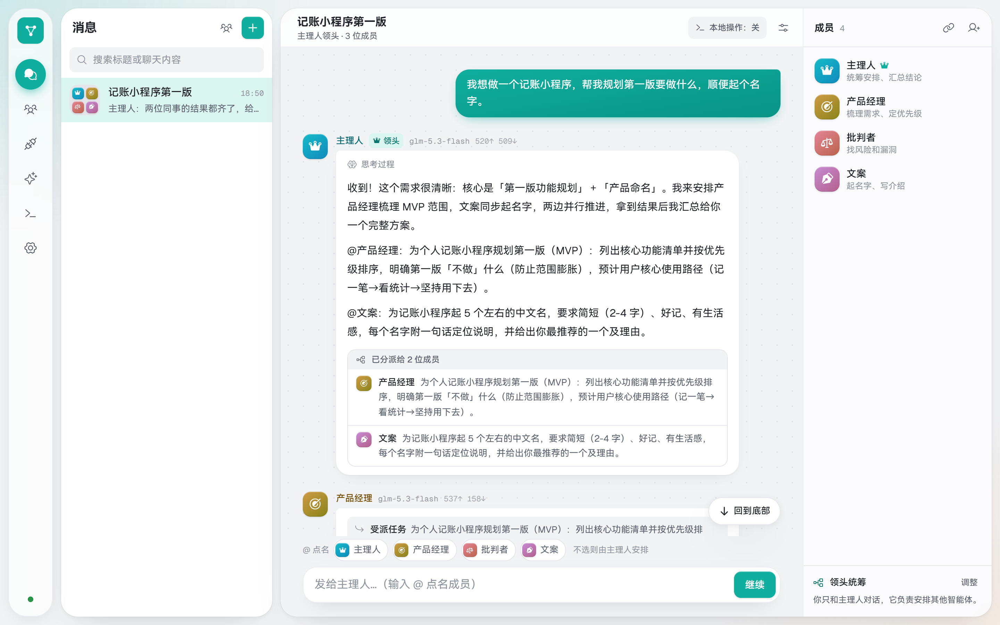

<p></p>

# Baize

Build your own AI team in a desktop app or browser. Give each agent a role and model, then work together in one conversation. Talk directly to members or let a lead agent assign tasks, review results and produce a combined answer. Conversations, configuration and workspace files are stored locally; requests to cloud models are sent to the selected provider.

[](https://github.com/Xiranwuxianxi/Baize/actions/workflows/ci.yml)
[](https://github.com/Xiranwuxianxi/Baize/actions/workflows/desktop.yml)
[Desktop installation guide](docs/desktop.en.md) · [MIT license](LICENSE)

**Desktop packages are available for Windows, macOS and Linux.** They include the frontend, Python backend and runtime, so end users do not need Node.js or Python. Source-based Web and Docker deployments are also supported.

[中文](README.md) · [Security](SECURITY.md) · [Contributing](CONTRIBUTING.md) · Detailed docs (Chinese): [orchestration](docs/orchestration.md), [external agents](docs/external-agents.md), [local operations](docs/local-access.md), [protocols](docs/protocols.md), [config](docs/config.md), [deployment](docs/deployment.md), [architecture](docs/architecture.md)



> The interface is primarily Chinese. An English option exists in Settings but currently covers navigation, page titles, common buttons and settings only.

## Why Baize?

Baize (白泽) is a wise creature from Chinese mythology. *Yunji Qiqian* describes it as able to speak and understand the nature of things. The name reflects this project's purpose: understand the strengths of different agents, connect models and tools, and help them work together under human guidance. **Different minds. Shared purpose.** Baize is the name's pinyin spelling.

The ivory guardian face, paired horns and violet mark form one visual identity across the desktop apps, installers, website and documentation. [Name source and logo](docs/branding.md).

## Compared with a single AI assistant

For simple Q&A a single assistant is faster and cheaper. A team pays off on complex work that needs different skills and someone to check the result:

| | One assistant | Baize |
|---|---|---|
| **Division of labor** | One model, one ever-growing prompt that has to cover everything | Each role has a focused setup; the lead runs a strong model, routine work goes to cheaper ones |
| **Checking** | Reviews its own work and tends to repeat its own blind spots | A dedicated critic, possibly on a different model, looks for problems; parallel mode compares several models on the same question |
| **Memory** | Everything in one memory, where your coding habits and bookkeeping categories get mixed up | **Each agent has its own memory**, kept across conversations and limited to its own area, so it gets to know you like a colleague |
| **Team lessons** | Corrected today, makes the same mistake in the next chat | After a correction or failed operation, a concrete rule goes into a shared library every agent follows |
| **Existing tools** | Only itself | Claude Code writes code, Kimi reviews, GLM summarizes, all in one conversation; agents on other computers can join too |
| **Cost** | One conversation | Multi-agent chat resends the conversation every turn. Token saving is on by default and cut input by about 47% on the same three-agent, four-round discussion; usage is shown per reply, conversation and day |
| **Transparency** | Hidden inside one answer | Who did what, which commands ran and how many tokens it took are all visible |

Also:

- **Hands-on, with you in control.** With local operations enabled, agents can run commands and read or write files. Every step first shows a card with the exact command and full path: deny, allow once, allow five times, or always allow.
- **Local first.** Data lives in a local SQLite file. Works with cloud APIs (Zhipu, DeepSeek, Qwen, OpenAI, Claude, Gemini…) and local models (Ollama, LM Studio, vLLM, llama.cpp); a thin laptop only needs a cloud model.

## Quick start

### Desktop app

Open the [Desktop packages workflow](https://github.com/Xiranwuxianxi/Baize/actions/workflows/desktop.yml), select a successful run and download the matching artifact at the bottom of the run page. GitHub sign-in is required to download artifacts.

| Platform | Artifact | Included packages |
| --- | --- | --- |
| Windows x64 | `Baize-windows-x64` | Setup EXE and portable EXE |
| macOS Apple Silicon | `Baize-macos-arm64` | DMG and application ZIP |
| macOS Intel | `Baize-macos-x64` | DMG and application ZIP |
| Linux x64 | `Baize-linux-x64` | AppImage / DEB |

Artifacts are retained for **30 days** and can be regenerated by running the workflow. Windows packages do not yet have a release certificate; macOS packages are ad-hoc signed and not notarized. See the [desktop guide](docs/desktop.en.md) for installation, updates, data locations and building all platforms.

After opening Baize: **add a model channel → create agents and choose a lead → start a conversation**. Enable local operations only when needed, with an appropriate workspace and approval mode.

The packages do not include model weights or API credits. Configure your own model provider, or run a local model service such as Ollama or LM Studio separately. External CLI agents and MCP servers still need their own dependencies.

### Run the Web app from source

Requires Python 3.10+ (3.12 recommended) and Node.js **22.12+**. Same command on Windows, macOS and Linux:

```bash
python run.py
```

Or double-click `start.bat` (Windows) / run `./start.sh` (macOS, Linux). The first run creates a virtual environment, installs dependencies and builds the frontend, then serves <http://localhost:18760>.

Then: **add a model channel → create a few agents (pick one as lead) → start a conversation.**

### Docker

```bash
docker compose up -d --build
```

Data lives in Docker volumes, not in the project folder. Agents in the container can only touch the container and the mounted workspace, not the host.

## Features

- **Agents and collaboration**: unlimited agents with name, avatar, role, model, temperature, max output and a thinking toggle; create agents mid-conversation. Four modes: relay, mention (type `@` for a member list), parallel, and lead-orchestrated (members work on their assignments simultaneously, shown side by side on a live task board, where each member can be stopped or redone on its own). Runs cut off by a server restart can be resumed with one click.
- **Attachments**: add images and files to a message (pick, paste or drag them in). Images are shrunk in the browser and sent to vision models; if a model can't see images it gets a text note instead. Text-like files go into the context, in full only for the newest message.
- **Export**: save a conversation as Markdown or a standalone web page.
- **External agents**: local CLI agents are invoked directly, with live output and a per-agent time limit; remote agents connect with their own per-agent token, without opening the whole console to the network.
- **Models**: OpenAI-compatible, OpenAI Responses, Anthropic, Gemini and Ollama native. Model lists are fetched when adding a channel. If an agent's max output exceeds what a model allows, the request is retried with the provider's limit and the limit is remembered.
- **Token saving and usage**: older messages are trimmed and history has a budget; skills and lessons are sent in full only when relevant; the system prompt stays identical between turns so providers can cache it; delegated members see only recent context. Usage stats by day, model, agent and conversation, using real provider counts when available.
- **Per-agent memory**: each agent records things worth keeping (your preferences and background, key project facts, decisions, approaches that worked) with a `<remember>` note, shown in chat with an undo button. It remembers them in new conversations; other agents don't see them. Pinned memories are always included, the rest only when relevant, so token cost stays low. View, edit, pin or delete them in the agent's settings, or turn memory off per agent. External agents such as Claude Code keep their own memory and are left alone.
- **Skills, MCP and lessons**: skills from text, SKILL.md or a URL, marked as installed vs. self-written, with update checks. MCP over stdio or Streamable HTTP; paste an existing `mcpServers` config. A "tool manager" agent installs skills and MCP servers from a URL right on those pages. Skills installed by command are registered automatically.
- **Local operations** (off by default): a folder per conversation plus folders you allow; paths outside are refused. Git Bash on Windows, UTF-8 output, a working `python`/`python3`. Open files in this computer's default app or reveal them in the file manager; scripts and programs are never launched by a click.
- **Interface**: chat-style UI for desktop and mobile, light/dark following the system, live sync across devices, pin/rename/search conversations, everything configurable in the UI.
- **Backup**: export or restore all data (channels, agents, chats, memory, lessons, usage, settings, optionally workspace files) in one click.

## Security in short

- LAN access is **off by default**: other devices get 403 until you enable it in Settings (set an access token too). To keep it strictly local, set `MAC_HOST=127.0.0.1`.
- Permission settings can only be changed from the machine running it.
- Local operations mean a model can run commands on your computer: off by default and approved step by step.
- Skills and MCP servers are other people's instructions and code: only add ones you trust.

See [SECURITY.md](SECURITY.md) (Chinese) for the full model.

## Configuration

Everything can be set in the UI. For scripted deployments, precedence is environment (including `.env`) > `config.yaml` > defaults.

| Purpose | config.yaml | Environment | Default |
| --- | --- | --- | --- |
| Bind address | `server.host` | `MAC_HOST` | `0.0.0.0` (LAN access still off until enabled) |
| Port | `server.port` | `MAC_PORT` | `18760` |
| Access token | `server.token` | `MAC_TOKEN` | empty |
| Your data folder (parent of the two below) | — | `MAC_HOME` | see “Where your data lives” |
| Database directory | `server.data_dir` | `MAC_DATA_DIR` | `<data folder>/data` |
| Workspace | `local_access.workspace` | `MAC_WORKSPACE` | `<data folder>/workspace` |
| Local operations | `local_access.enabled` | `MAC_LOCAL_ACCESS=1` | off |

### Where your data lives

Code and personal data are kept apart. The project folder contains only code; your database (channels, keys, agents, chats, memory, usage), workspace and your own `config.yaml` / `.env` live in the per-user app data folder: `%APPDATA%\Baize` on Windows, `~/Library/Application Support/Baize` on macOS, `~/.local/share/baize` on Linux. Copying, updating or publishing the project never includes your data. Set `MAC_HOME` to use another folder. Data from older versions (inside the project's `data/` and `workspace/`, or the pre-rename `MultiAgentsControl` folders) is moved there automatically on first start, without overwriting anything.

## Development

To contribute, see [CONTRIBUTING.md](CONTRIBUTING.md) (Chinese) for the full fork → branch → pull request steps. Use `MAC_HOME=./.dev-home` while developing so test data never mixes with your everyday data, and run `python scripts/check_release.py` before publishing to make sure no database, key or personal path slipped in.

```bash
backend/.venv/bin/python backend/main.py   # backend on 18760 (Windows: backend\.venv\Scripts\python)
npm --prefix frontend run dev              # frontend dev server on 18761, proxied to the backend
```

Tests never touch your data: unit tests use a temporary database, end-to-end tests start their own temporary server.

```bash
pip install -r backend/requirements-dev.txt
python -m pytest tests/unit          # seconds, no model needed
npm --prefix frontend ci && npm --prefix frontend run check   # frontend: ESLint, TypeScript, Vitest

export MAC_TEST_BASE_URL=https://api.example.com/v1 MAC_TEST_API_KEY=... MAC_TEST_MODEL=your-model
python tests/run_e2e.py              # end-to-end on a cloud model; tests that need local Ollama are skipped by default
```

## Known limitations

- Verified in practice with Zhipu GLM (OpenAI-compatible) and local Ollama (native, OpenAI-compatible, Responses and Anthropic-compatible endpoints). Gemini and other cloud services follow the official API formats; please open an issue if something breaks.
- Lead orchestration relies on the lead writing `@member: task`; very small models can be unreliable, so give the lead a capable model.
- Local operations, skills and MCP calls use native tool calling on the OpenAI-compatible and Anthropic protocols (verified on both Zhipu GLM endpoints); Gemini, Responses and Ollama, and any channel that rejects tool parameters, fall back to text tags.
- CI covers Windows, macOS and Linux. Desktop packages are built on native runners and checked for startup and packaged contents; this does not replace long-term testing on every supported OS version.
- Desktop release certificates and macOS notarization are not configured. Mobile browsers can access the Web interface; native Android/iOS packages are not currently provided.
- English UI is partial (see above); single-user, no accounts.

## License

[MIT](LICENSE)
