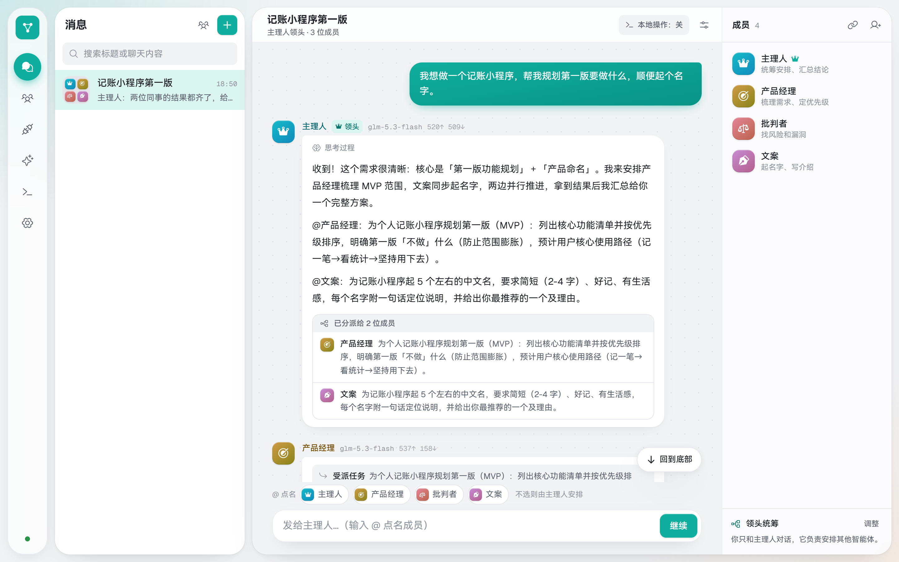
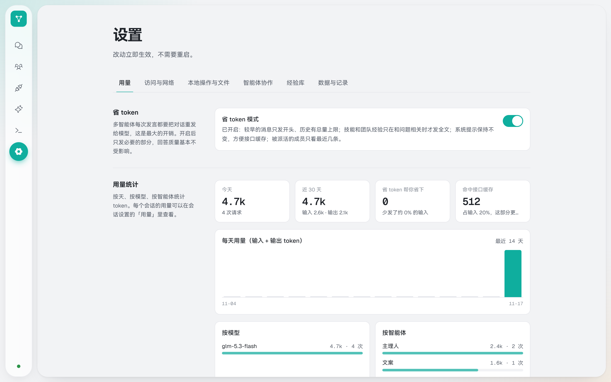
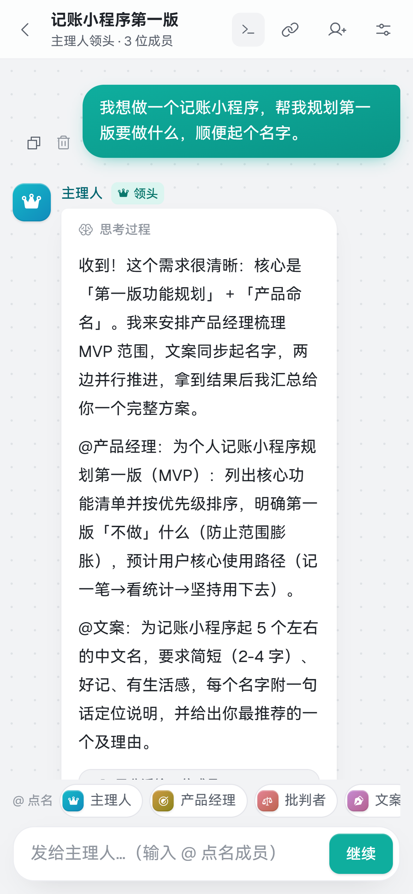

<p></p>

# 白泽 · 多智能体控制台（Baize）

在桌面应用或浏览器里组建你自己的 AI 团队：随意创建智能体，给它们起名字、写角色设定、接上模型，让它们在同一个会话里分工协作。你可以直接和成员交流，也可以让领头人分派任务、审阅结果并汇总答复。聊天记录、配置和工作区保存在本机；使用云端模型时，模型请求仍会发给对应服务商。

[](https://github.com/Xiranwuxianxi/Baize/actions/workflows/ci.yml)
[](https://github.com/Xiranwuxianxi/Baize/actions/workflows/desktop.yml)
[MIT 开源许可证](LICENSE)

**Windows / macOS / Linux 桌面版已提供。** 桌面安装包内含前端、Python 后端和运行环境，使用者无需另外安装 Node.js 或 Python。也可以从源码运行 Web 版，或使用 Docker 自托管。

[English](README.en.md) · [桌面版下载与使用](docs/desktop.md) · [协作方式](docs/orchestration.md) · [接入外部智能体](docs/external-agents.md) · [本地操作](docs/local-access.md) · [连接协议](docs/protocols.md) · [配置文件](docs/config.md) · [部署](docs/deployment.md) · [架构](docs/architecture.md) · [安全说明](SECURITY.md) · [参与贡献](CONTRIBUTING.md)



<table>
<tr>
<td width="62%"></td>
<td></td>
</tr>
</table>

## 为什么叫白泽？

白泽是中国传说中的智慧瑞兽。《云笈七签·轩辕本纪》记载它“能言，达于万物之情”。项目借用这一意象：理解不同智能体的专长，连接模型与工具，让它们在人的掌控下协作。**知各有所长，协众智成事。** Baize 是“白泽”的拼音形式，作为英文产品名。

新标志以白玉般的兽面、双角和紫色额纹演绎白泽，统一用于桌面应用、安装包、网页与文档。[命名出处与标志说明](docs/branding.md)。

## 和只用一个 AI 助手比，好在哪

先说清楚：简单的问答，一个助手更快、更省。多智能体的价值在**复杂、需要不同专长、需要互相把关**的任务上：

|              | 一个助手                                                 | 多智能体控制台                                                                                                                             |
| ------------ | -------------------------------------------------------- | ------------------------------------------------------------------------------------------------------------------------------------------ |
| **分工**     | 一个模型、一段越写越长的提示词，什么都要会               | 每个角色有自己专注的设定；领头人用强模型，写文案、整理这类活交给便宜的模型                                                                 |
| **把关**     | 自己检查自己，容易一错到底                               | 专门的「批判者」用自己的视角、甚至另一个模型来挑毛病；并行模式下同一问题可以对比多个模型的答案                                             |
| **记忆**     | 所有东西堆在一个记忆里，写代码的习惯和记账的分类互相干扰 | **每个智能体有自己独立的记忆**，跨会话保留、只记它那一摊的事，像同事一样越用越懂你                                                         |
| **团队经验** | 这次纠正了，下次换个对话又犯                             | 被纠正或操作失败后，具体规则记进共享经验库，全队以后都照做                                                                                 |
| **已有工具** | 只能用它自己                                             | Claude Code 写代码、Kimi 复核、GLM 汇总，一个会话里统一调度；别的电脑上的智能体也能连进来                                                  |
| **成本**     | 一份对话                                                 | 多智能体最大的开销是每次发言都重发整段对话。这里默认省 token：实测同一段三人四轮讨论输入减少约 47%，每条回复、每个会话、每天的用量都看得到 |
| **过程**     | 藏在一段回答里                                           | 谁做了什么、执行了什么命令、用了多少 token，一目了然                                                                                       |

另外：

- **能动手，但每一步你说了算**：开启本地操作后，智能体可以执行命令、读写文件，每一步先弹出卡片写明命令和完整路径，你选不允许 / 允许一次 / 允许五次 / 永久允许。
- **本地优先**：数据存在本机 SQLite；云端接口（智谱、DeepSeek、通义、OpenAI、Claude、Gemini……）和本地模型（Ollama、LM Studio 等）都能用，轻薄本用云端模型就够了。

## 快速开始

### 方式一：安装桌面版

打开 [Desktop packages 构建页面](https://github.com/Xiranwuxianxi/Baize/actions/workflows/desktop.yml)，选择最近一次成功的运行，在页面底部 **Artifacts** 下载对应平台的压缩包。下载构建产物需要登录 GitHub。

| 系统 | 应选择的产物 | 包内文件与使用方式 |
| --- | --- | --- |
| Windows x64 | `Baize-windows-x64` | `*-setup.exe` 为安装版，`*-portable.exe` 为免安装版，选择一个运行即可 |
| macOS，Apple Silicon（M 系列） | `Baize-macos-arm64` | DMG 安装包和应用 ZIP；打开 DMG 后将 Baize 拖到 Applications |
| macOS，Intel | `Baize-macos-x64` | DMG 安装包和应用 ZIP，使用方式同上 |
| Linux x64 | `Baize-linux-x64` | AppImage / DEB |

构建产物保留 **30 天**，到期后可重新运行工作流生成。当前 Windows 包没有发行证书签名，macOS 包为临时签名、未经过 Apple 公证，系统可能提示来源未验证。完整的安装、更新、数据位置、构建与常见问题见 [桌面版指南](docs/desktop.md)。

### 第一次使用

1. 打开 Baize，按界面引导添加模型渠道，填写服务地址、模型和需要的 API 密钥。
2. 创建智能体，设置角色及模型；使用领头统筹时，选择一位领头人和参与成员。
3. 新建会话并发送任务，查看成员的流式输出、任务看板和用量统计。
4. 需要读写文件或执行命令时，再开启本地操作，并选择允许使用的工作区和审批方式。

安装包不包含模型权重，也不提供模型额度。云端模型使用你自己的 API 服务；Ollama、LM Studio 等本地模型服务需要另外运行。外部 CLI 智能体和 MCP 服务器也按各自要求安装。

### 方式二：从源码运行 Web 版

环境要求：Python 3.10+（推荐 3.12）、Node.js **22.12+**。三个系统都是同一条命令：

```bash
python run.py
```

也可以双击 `start.bat`（Windows）或运行 `./start.sh`（macOS / Linux）。首次运行会自动创建虚拟环境、安装依赖、构建前端，然后打开 [http://localhost:18760](http://localhost:18760)。

按界面引导三步走：**接入模型渠道 → 建几个智能体（选一位做领头人） → 开始会话**。

### 方式三：Docker 自托管

```bash
docker compose up -d --build
```

数据存在 Docker 卷里（不在项目文件夹中）。容器里的智能体只能操作容器内的环境和挂载的工作区，管不了宿主机。想让智能体管理电脑本身，请直接运行。详见 [部署](docs/deployment.md)。

## 功能一览

**智能体与协作**

- 智能体不限数量：名字、头像（内置或上传）、简介、角色设定、模型、温度、最大输出、深度思考开关，都可单独设置；也可以在会话里当场新建，并选择是否加入全局。
- 四种协作方式：接力（轮流发言，可多轮）、点名（输入 @ 弹出成员列表）、并行（同时作答、互不可见）、领头统筹（领头人分派后，成员同时开工、各自交付，会话里以任务看板并排显示每个人的进度）。
- 任务看板上可以单独停止或重做某一位成员；服务重启时被打断的会话一键继续。
- 消息可以带图片和文件（选择、粘贴或拖进来）：图片发给支持看图的模型，文本类文件把内容带进上下文。
- 外部智能体：本机命令行智能体直接调用，输出边写边显示，可单独设置超时；其他电脑上的智能体凭专属口令连接，不需要打开整个控制台的局域网访问。见 [接入外部智能体](docs/external-agents.md)。

**模型**

- 五种协议：OpenAI 兼容、OpenAI Responses、Anthropic、Gemini、Ollama 原生。添加渠道时直接拉取模型列表。
- 「最大输出 Token」填得比模型允许的大时，自动按接口给出的上限重试并记住，不会报错。

**省 token 与用量**

- 较早的消息只发开头，历史有总量上限；技能和团队经验只在和问题相关时才发全文；系统提示每轮保持不变，便于各家接口缓存；被派活的成员只看最近几条。设置里可以关闭。
- 用量统计：按天、模型、智能体、会话统计，优先使用接口返回的真实用量，显示省下多少、命中缓存多少。

**记忆**

- 每个智能体有自己独立的记忆：遇到以后用得上的信息（你的偏好和背景、项目的关键事实、定下的决定、摸索出的有效做法），它会自己记下，会话里提示「记住了：…」，可以当场撤销。
- 换一个新会话它也记得；别的智能体看不到。置顶的记忆每次都带上，其余只在和问题相关时才带上，不怎么增加用量。
- 在智能体设置里查看、搜索、修改、置顶、删除它的记忆，也可以单独关掉某个智能体的记忆。Claude Code 这类外部智能体有自己的记忆系统，不在这里管。

**技能、MCP 与经验库**

- 技能：手写、粘贴 SKILL.md、或贴网址添加；区分外部安装和自己写的，外部技能可检查更新、一键升级。
- MCP：支持 stdio 和 Streamable HTTP，可以直接粘贴其他客户端的 `mcpServers` 配置。
- 工具管家：在技能页或 MCP 页贴网址或说一句需求，它就地完成安装，进度在小窗里显示，装好自动消失。
- 共享经验库：有明确的记录标准（被纠正 / 收到规定 / 操作失败，内容具体、不重复），可以在设置里查看、搜索、修改。

**本地操作**（默认关闭）

- 每个会话有自己的文件夹，可另外指定允许的文件夹；越界的路径一律拒绝。
- Windows 上自动使用 Git Bash；命令统一 UTF-8 输出，`python` / `python3` 指向真正可用的 Python。
- 智能体写出的文件可以直接用本机对应的应用打开，或在文件夹中定位；脚本和程序不会被直接运行。

**界面**

- IM 风格，手机和电脑都能用，跟随系统深浅色；多台设备同时打开时实时同步。
- 会话可以导出成 Markdown 或独立网页，方便存档和分享。
- 会话可以置顶、改名、搜索标题和聊天内容；所有设置都在界面里改，立即生效。
- 一键导出 / 恢复全部数据（渠道、智能体、会话、记忆、经验、用量、设置，可选连同工作区文件），换电脑、升级前留一份。

## 配置

全部都能在界面里设置。需要批量部署或纳入版本管理时，也可以用配置文件和环境变量，优先级：环境变量（含 `.env`） > `config.yaml` > 默认值。

| 用途                               | config.yaml              | 环境变量             | 默认                                    |
| ---------------------------------- | ------------------------ | -------------------- | --------------------------------------- |
| 监听地址                           | `server.host`            | `MAC_HOST`           | `0.0.0.0`（但局域网访问默认关闭，见下） |
| 端口                               | `server.port`            | `MAC_PORT`           | `18760`                                 |
| 访问口令                           | `server.token`           | `MAC_TOKEN`          | 空                                      |
| 你的数据目录（下面两项的默认上级） | —                        | `MAC_HOME`           | 见下方「你的数据放在哪」                |
| 数据库目录                         | `server.data_dir`        | `MAC_DATA_DIR`       | `<你的数据目录>/data`                   |
| 工作区                             | `local_access.workspace` | `MAC_WORKSPACE`      | `<你的数据目录>/workspace`              |
| 开启本地操作                       | `local_access.enabled`   | `MAC_LOCAL_ACCESS=1` | 关闭                                    |

渠道和智能体也可以写在 `config.yaml` 里声明，见 [配置文件](docs/config.md)。

### 你的数据放在哪

**代码和你的数据是分开的。** 项目文件夹里只有代码；数据库（渠道、密钥、智能体、聊天记录、记忆、用量）、工作区、你自己的 `config.yaml` 和 `.env`，默认都放在系统给每个用户的应用数据目录里：

| 系统    | 位置                                  |
| ------- | ------------------------------------- |
| Windows | `%APPDATA%\Baize`                     |
| macOS   | `~/Library/Application Support/Baize` |
| Linux   | `~/.local/share/baize`                |

所以复制、打包、更新、发布项目文件夹都不会带上你的数据；删掉项目重新下载，数据也还在。启动窗口和「设置 → 数据与记录」里都会显示实际位置，并能一键打开。想放到别处（比如另一块硬盘），设置环境变量 `MAC_HOME` 指向新文件夹，把旧文件夹整个搬过去即可。

从旧版本升级：旧版本把数据放在项目文件夹的 `data/`、`workspace/` 里，第一次启动新版本时会自动搬到上面的位置（目标位置已有数据时不会覆盖）。改名前的数据目录（`MultiAgentsControl` / `multi-agents-control`）同样会自动搬过来。

## 安全

- **局域网访问默认关闭**：其他设备打开会看到 403，需要在「设置 → 访问与网络」里手动开启（建议同时设置访问口令）。只想自己用，把 `MAC_HOST` 设为 `127.0.0.1`。
- **权限类设置只能在本机修改**；开着本地操作又没设口令时，其他设备只能查看。
- **本地操作等于让模型在你的电脑上执行命令**：默认关闭，每一步都要你批准。处理不可信内容（网页、陌生文件）的会话不要开免审批。
- **技能和 MCP 是别人的指令和代码**：只添加来源可信的。

完整说明见 [SECURITY.md](SECURITY.md)。

## 支持的模型服务

| 协议                           | 适用                                                                                                         |
| ------------------------------ | ------------------------------------------------------------------------------------------------------------ |
| OpenAI 兼容 (Chat Completions) | OpenAI、DeepSeek、通义千问、智谱、Moonshot、硅基流动、OpenRouter，以及 LM Studio、vLLM、llama.cpp 等本地服务 |
| OpenAI Responses API           | OpenAI `/responses`                                                                                          |
| Anthropic Messages API         | Claude 及兼容网关                                                                                            |
| Google Gemini API              | Gemini 原生协议                                                                                              |
| Ollama 原生 API                | 本机 Ollama `/api/chat`                                                                                      |

各协议的地址写法见 [docs/protocols.md](docs/protocols.md)。

## 项目结构

```
backend/              FastAPI 后端（按功能拆分的模块，见 docs/architecture.md）
  main.py             组装：访问控制、渠道 / 智能体 / 会话 / 设置接口、WebSocket
  orchestra.py        编排：发言、本地操作审批、领头人分派、新建成员
  context.py          上下文拼装与省 token 裁剪
  providers.py        五种协议的流式适配
  skills.py           技能、MCP、工具管家      lessons.py  共享经验库
  memory.py           每个智能体自己的记忆
  external.py         外部智能体                usage.py    用量统计
  tools.py            本地操作的执行与安全边界  files.py    会话文件夹与打开文件
frontend/             React + Tailwind（Vite 构建，产物由后端托管）
desktop/              Electron 桌面入口、打包配置、运行文件审计与启动检查
.github/workflows/desktop.yml  一次触发 Windows、Linux、macOS 两种架构的构建
tests/unit/           离线单元测试（CI 每次运行）
tests/e2e_*.py        端到端测试（连真实模型，跑在临时服务器上）
docs/                 文档与截图
run.py                跨平台启动器       Dockerfile / docker-compose.yml  容器部署
```

## 开发

```bash
backend/.venv/bin/python backend/main.py   # 后端，18760（Windows 用 backend\.venv\Scripts\python）
npm --prefix frontend run dev              # 前端开发服务器，18761，已配置接口代理
```

测试**不会碰你的数据**：单元测试用临时库，端到端测试会自己起一个临时服务器。

```bash
pip install -r backend/requirements-dev.txt
python -m pytest tests/unit          # 几秒，不需要模型
npm --prefix frontend ci && npm --prefix frontend run check   # 前端：ESLint、TypeScript 类型检查、Vitest

export MAC_TEST_BASE_URL=https://open.bigmodel.cn/api/paas/v4 MAC_TEST_API_KEY=... MAC_TEST_MODEL=glm-5.3-flash
python tests/run_e2e.py              # 端到端，只用云端模型；需要本机 Ollama 的测试默认跳过
```

想参与贡献：[参与贡献](CONTRIBUTING.md) 里有从 Fork 到发起合并请求的完整步骤。开发时用 `MAC_HOME=./.dev-home` 起一份独立的开发数据，不影响你日常使用的那份；发布或提交前运行 `python scripts/check_release.py`，确认没有带上数据库、密钥或个人路径。测试细节见 [tests/README.md](tests/README.md)。

## 已知限制

- 作者实际验证过的模型服务是智谱 GLM（OpenAI 兼容协议）和本机 Ollama（经由它的原生、OpenAI 兼容、Responses、Anthropic 兼容四个接口）。Gemini 和其他云端服务按官方接口格式实现，遇到问题欢迎提 Issue。
- 领头统筹依赖领头人按「@成员：任务」的格式输出，过小的模型可能不稳定，建议领头人用能力较强的模型。
- 本地操作、技能、MCP 调用在 OpenAI 兼容和 Anthropic 协议上走原生工具调用（已在智谱 GLM 两种接口上验证）；Gemini、Responses、Ollama 协议，以及拒绝工具参数的渠道，自动退回文本标签，过小的模型可能不按格式输出。
- CI 覆盖 Windows、macOS、Linux；桌面构建分别在原生构建机上生成，并执行启动检查和包内容审计。自动检查不能代替所有系统版本上的长期使用测试。
- 当前桌面版未完成发行证书签名和 Apple 公证；移动设备可通过网页访问，当前没有 Android / iOS 原生安装包。
- 界面以中文为主：设置里可以切换到 English，但目前只翻译了导航、页面标题、常用按钮和设置项，其余仍是中文（按文件逐步翻译，见 `frontend/src/lib/locales/en.ts`）。单用户设计，没有账号体系。

## 许可证

[MIT](LICENSE)
